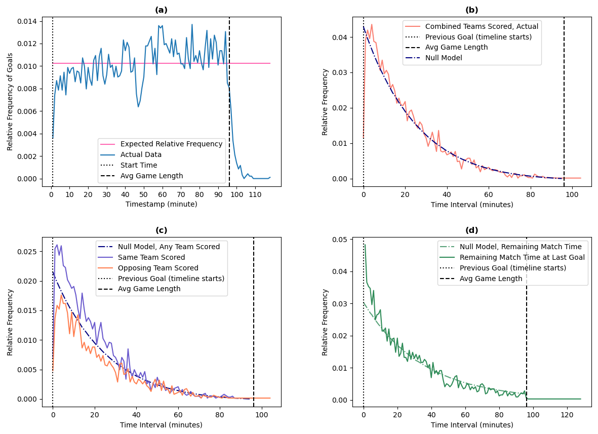
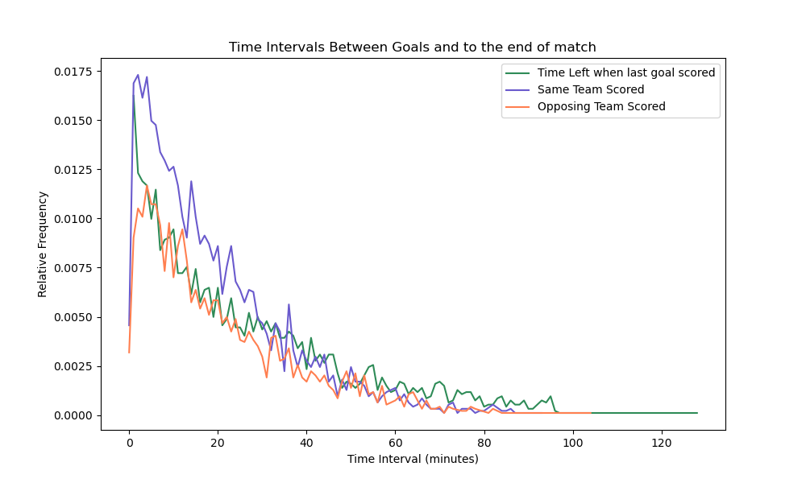
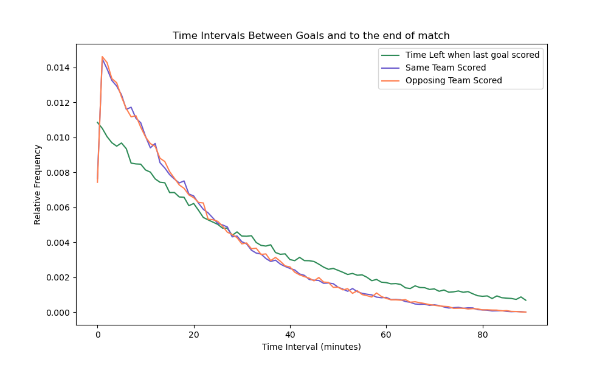
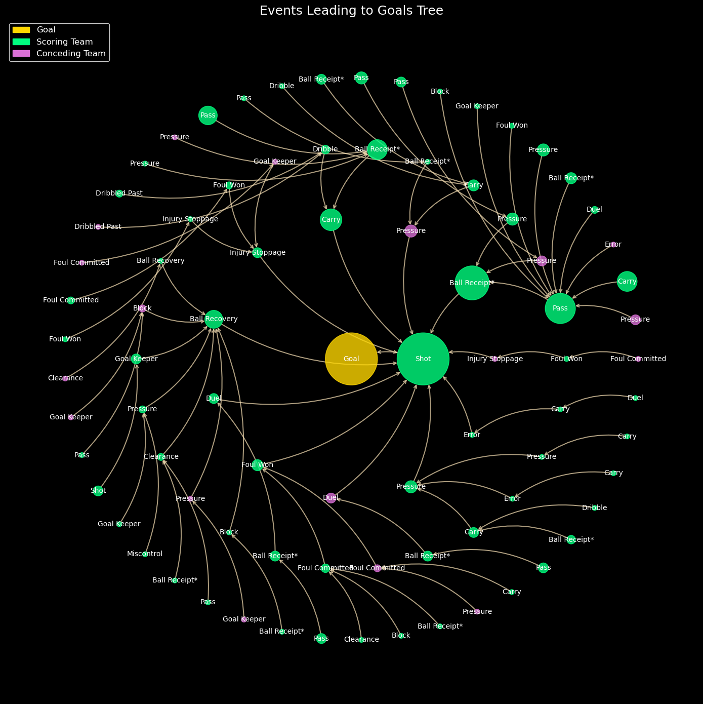
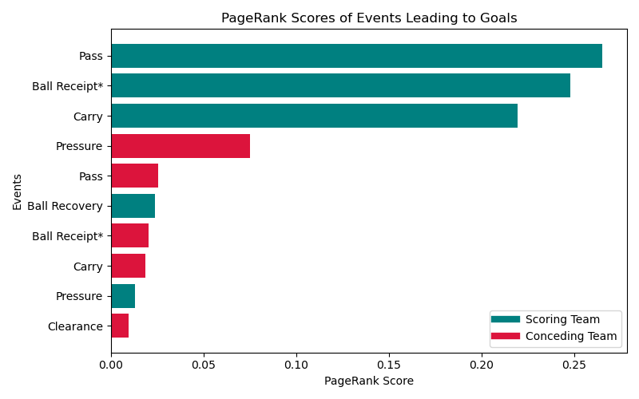

# Temporal Dynamics of Goal Scoring in Soccer

[](https://arxiv.org/abs/2501.18606)

[](LICENSE)

Code and figures for **[_Temporal dynamics of goal scoring in soccer_](https://arxiv.org/abs/2501.18606)** (arXiv:2501.18606, 2025). The research was done at the **Network Science Institute, Northeastern University**.

**Is the timing of goals in soccer random?** Using event-level data from **3,433 matches across 21 leagues and competitions**, we compare when goals actually happen with a null model in which goals arrive at a constant rate. The answer is no:

- **Goals become more likely as a match goes on**, and fewer goals than expected are scored early in each half.
- **The time between goals decays exponentially.** Overall, this pattern is explained by the average scoring rate.
- **Goal scoring is "bursty."** Split by who scores next, the team that just scored is more likely to score again soon than chance predicts, and the conceding team is less likely to.
- **The last goal of a match tends to come later** than the null model expects.


<sub>Figure 1 from the paper. (a) Goal frequency by minute vs. a uniform expectation. (b) Time between goals vs. the null model. (c) The same split by the team that scores next. (d) Time remaining at the last goal.</sub>

---

## Data: Hudl StatsBomb Open Data


**Data source: StatsBomb.** All match data comes from the free [StatsBomb Open Data](https://github.com/statsbomb/open-data) release (Hudl StatsBomb). It records every on-ball action in a match (passes, carries, pressures, shots and more) with timestamps and locations. The matches cover competitions including the FIFA World Cup, AFCON, Premier League, Bundesliga, La Liga, Serie A, Champions League, MLS and NWSL.

**The data is not included in this repository.** To reproduce the analysis, download it and put its `data/` folder at the project root. It is excluded by `.gitignore`.

```
amr-soccer/
├── data/                         # ← from statsbomb/open-data (not committed)
│   ├── competitions.json
│   ├── matches/<competition_id>/<season_id>.json
│   ├── lineups/<match_id>.json
│   └── events/<match_id>.json
├── src/
└── figs/
```

---

## Method

**Goal timing.** For every goal, we take the match minute and shift second-half timestamps by the first half's stoppage time so they line up. Across all matches, we compare the distribution with a uniform one: a χ² test gives χ² ≈ 288.6 and p ≈ 3.7 × 10⁻²¹, and the upward trend gives r ≈ 0.44 and p ≈ 7.1 × 10⁻⁶.

**Time between goals.** In matches with two or more goals, we measure the gap from the **restart after one goal to the next goal**. We label each gap _same team_ or _opposing team_ by who scored next. We also record the match time left after the final goal.

**Null model.** We simulate **6,000,000 matches** in which goals arrive at the observed average rate per minute, and each goal is randomly assigned to one of the two teams. Any gap between real and simulated distributions points to match context such as momentum, fatigue or tactics.

| Observed | Null model |
|---|---|
|  |  |

## Extension: what leads to a goal (beyond the paper)

The paper's discussion calls for studying **the build-up to goals**. This repo includes a first pass at that. For each goal, we walk backward through the possession and label each event by **type** (Pass, Carry, Pressure, …) and **side** (scoring or conceding team). We then:

- build a **goal tree (trie)** of these sequences, with node size showing how often each one occurs, and
- build a weighted **event transition network** and rank events with **PageRank** (NetworkX).

| Goal tree, Bundesliga 2023/24 | PageRank of events before goals |
|---|---|
|  |  |

The scoring team's **Pass → Ball Receipt → Carry** chain dominates. The conceding team's most important event is **Pressure** that fails to win the ball, and **Ball Recoveries** are a common starting point for transition goals.

### Other exploratory figures
- `figs/goals-by-minute.png`, `figs/time-between/stacked/`: goal counts by minute and by 10-minute window
- `figs/shot_distances.png`, `figs/goal_distances.png`: shot and goal distances from goal
- `figs/shot-maps/`, `figs/passing-map-*.png`: single-match shot and passing maps

---

## Code

| File | What it does |
|---|---|
| `src/bar_charts.py` | Extracts goal times and inter-goal intervals, builds the constant-rate null model, and plots the timing figures |
| `src/utils.py` | Shared loaders (`read_game_file`, `get_file_names`) plus helpers for goals, passes, shot maps and timing |
| `src/goal_network.py` | Builds goal trees and event transition networks, runs PageRank, and makes the network plots |
| `src/example_net.py` | A minimal end-to-end event network for the Premier League 2015/16 |

### Running it

```bash
git clone https://github.com/<your-username>/amr-soccer.git
cd amr-soccer

# get the data (large download)
git clone --depth 1 https://github.com/statsbomb/open-data.git sb-open-data
mv sb-open-data/data ./data && rm -rf sb-open-data

pip install -r requirements.txt   # goal_network.py also needs Graphviz: brew install graphviz

cd src
python bar_charts.py     # goal-timing plots
python goal_network.py   # goal trees / PageRank
```

All scripts read data from `../data/`, so run them from inside `src/`.

**Tech:** Python · NumPy · pandas · Matplotlib · Seaborn · NetworkX · Graphviz

---

## Authors

**Guteraa Ayana**\*¹, **Alexander Ehlert**\*¹, Joseph Ehlert², Luca Santagata², Maddalena Torricelli², Brennan Klein²

¹ Breck School, Golden Valley, MN · ² Network Science Institute, Northeastern University, Boston, MA
\* Equal contribution as first authors

Thanks to Alessandro Vespignani for helpful discussions and feedback.

## Citation

```bibtex
@misc{ayana2025temporal,
  title         = {Temporal dynamics of goal scoring in soccer},
  author        = {Ayana, Guteraa and Ehlert, Alexander and Ehlert, Joseph and Santagata, Luca and Torricelli, Maddalena and Klein, Brennan},
  year          = {2025},
  eprint        = {2501.18606},
  archivePrefix = {arXiv},
  primaryClass  = {physics.soc-ph},
  url           = {https://arxiv.org/abs/2501.18606}
}
```

## License

The code is released under the [MIT License](LICENSE). The StatsBomb data is subject to [StatsBomb's own terms](https://github.com/statsbomb/open-data#terms--conditions) and is not covered by this license.
